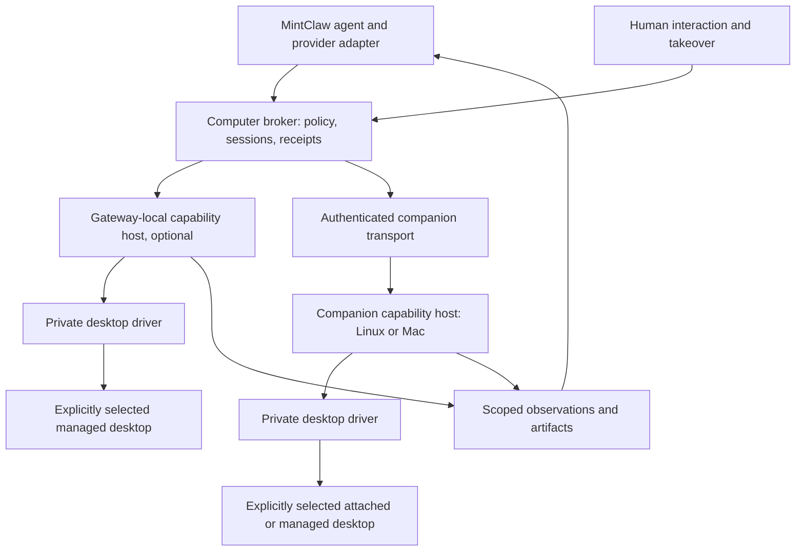

# MintClaw cross-platform computer-use roadmap

Status: in progress. Updated: 2026-10-18. The opt-in read-only Linux and macOS
milestone is implemented, natively qualified and merged. Public native input,
full interactive task evaluation and the production pilot are not complete.
Production desktop control remains disabled by default.

## Decision and scope

Add a typed, provider-neutral computer capability to MintClaw. Use the existing
AgentLoop/Pipeline and companion protocol; execute OS operations in a private
replaceable worker. Qualify CuaDriver first, compare Peekaboo on Mac and a small
Linux X11 baseline, and choose defaults from measured results.

The current implementation and measured limits are recorded in the
[native qualification](computer-use-native-qualification.md),
[companion boundary](computer-companion-boundary.md) and
[public gateway tools](computer-gateway-tools.md) documents. This roadmap retains
the original acceptance requirements; a merged read-only milestone is not a
claim that input or the full roadmap is complete.

The proposed MVP supports explicitly selected attached Linux and macOS desktops
through companion capability hosts. A Linux companion may run on the same
machine as the gateway, but in the selected GUI user's login session. The gateway
remains headless; it does not inherit control of whichever desktop happens to be
logged in. Companions host capture/input, not model reasoning or provider credentials.

Hosting location, attached versus managed lifetime, isolation, and driver are
independent choices. A managed Linux desktop is an optional follow-up, not a
prerequisite for attached Linux. No failure may silently change the selected
desktop or its mode. Installation and permission changes require operator approval.

MVP workflows include observing native apps, bounded click/type/key/scroll/drag,
simple document-app interactions, and reliable human takeover/resume/finish.
Existing browser automation remains preferred for web tasks. Native desktop
fallback requires its own grant, including for an OS dialog opened by a browser.

Excluded initially: privileged system input, arbitrary generated host code,
unattended purchases or credential entry, arbitrary native Wayland compositors,
GPU model hosting on the small Linux server, automatic clipboard monitoring, and
Mac VM management. Artifact/PDF editing through an API or file library should
still use the semantic tool rather than GUI automation when it fits the task.

## Ownership and execution boundaries

The broker owns admission, task/session identity, control generations, approval
bindings, budgets, receipts, and reporting. The capability host revalidates
authority immediately before local execution. A driver provides mechanisms,
not authorization. MCP can be a private worker protocol; attaching a general
desktop MCP server must not bypass these boundaries.

Register tools through the existing runtime capability composition. Skills may
describe usage but must not grant authority. Keep backend details out of agent
prompts and avoid adding a second agent framework merely to obtain input APIs.

## Capability contract

The first three tools below are implemented under explicit read-only grants.
`computer_act` is a planned separate input surface, not an existing model tool.

| Surface | Contract |
| --- | --- |
| `computer_targets` | Advertise explicit node/environment/display/window targets, backend versions, capabilities, and permission/readiness failures. Do not return every window title unless that scope is authorized. |
| `computer_session` | Open/status/release a scoped control lease with explicit target and environment lifetime. No silent replacement desktop or node. |
| `computer_observe` | Return a fresh screenshot and optional accessibility observation, geometry, observation ID, target identity, and capture provenance. |
| `computer_act` | Execute a supported typed action against that session and observation; return a durable receipt and fresh evidence or an explicit verification failure. |
| Human interaction | Transfer/reacquire/release control through the existing durable interaction mechanism, with localized content and latest user intent. |

A target identifies node, OS login/desktop instance, display, and, when scoped,
window/process generation. An observation carries capture dimensions, origin,
scale, and coordinate-space metadata. Keep original pixels when possible; any
resize or crop needs an explicit reversible transform. Include Retina, negative
monitor origins, and multiple displays in tests.

Bind input to the runtime principal, session/control generation, target scope,
policy revision, worker identity, and fresh observation. Validate geometry,
window identity, focus where required, and expiry immediately before dispatch.
Detectable mismatches fail closed. Native GUIs cannot promise an atomic
observe-and-click transaction; document the residual race and use semantic
targeted operations when available.

Use an input lock shared by all MintClaw profiles controlling the same desktop.
An isolated desktop permits a desktop-wide grant within that environment. On a
live personal desktop, constrain observations and input to approved resources;
unsupported targeting requires explicit supervised foreground control, not a
fallback to a different app. Background operation is a qualified capability,
not an unconditional promise.

An invocation ID records accepted/not-started/running/succeeded/failed/outcome-unknown
states. A durably accepted invocation proven not started can execute once. A lost
acknowledgement after dispatch must not trigger a blind retry of input. Consult the
ledger and observe again; never claim exactly-once business effects. Cancellation
must stop queued input, release held keys/buttons, revoke the control generation,
and report anything already executed or uncertain.

Measure model round trips as well as driver latency. Small typed action batches
may reduce overhead, but must not cross a required observation, changed control
generation, or approval boundary. Generated code, if added later, runs only in an
explicitly authorized isolated environment with executor-enforced limits; it is
not a generic shortcut around the live-desktop contract.

## Human control and honest lifecycle reporting

Track control separately from desktop/application lifetime:

`agent_control -> human_control -> resume_pending -> agent_control`

Any nonterminal control state can move to `released`; execution failures can move
to `lost`. Transitions use typed events and monotonically increasing generations.
Releasing automation must not automatically close a user-owned application on
either OS. Retaining a managed desktop needs an explicit bounded retention policy;
destroying it is a separate cleanup operation with a receipt.

At handoff, stop automated input before enabling human input. Include the actual
result so far, original conversation language, and an open next-step question when
appropriate. Reuse the existing live-handoff resolver and model-based continuation
decision. The resolver may rebind ownership to validate a durable receipt before
that decision, but must not perform input. Interpret the latest user message
before resuming external observation or action: finishing, cancelling, or changing
the task must supersede the old plan. Continue with revalidated authority and a
fresh observation of the same target; finish performs only the required release.

Do not add dictionaries of finish phrases, Amazon-specific checks, or
button-title heuristics. The agent interprets natural-language intent into typed
control events; runtime code enforces those events and ownership. Native stop
controls provide a deterministic escape path independently of interpretation.

Completion and delivery should consume runtime receipts. Distinguish “automation
released,” “application observed open at time T,” “managed desktop retained until
T,” “environment closed,” and “state unverified.” A screenshot from before cleanup
does not prove that a window remains open after cleanup. Close progress messages
and outstanding interactions exactly once on finish, failure, or cancellation.

Shared finalization now verifies disposition through the owning registered tool
and its trusted lifecycle receipt, rather than assuming every resource is a
browser close. Preserve this boundary as input is added. Attached-desktop release,
browser close and managed-environment destruction remain distinct operations;
keep mixed-resource finalization regressions.

## Security, privacy, and platform readiness

Keep capability policy, approval policy, and model-declared effects separate.
Effect descriptions and accessibility labels are not security authority. For an
opaque pixel action, the runtime cannot prove that it is harmless just because
the model says so. Start with operator-approved fixture apps and supervised
input; broad unattended live-desktop control is not an MVP entitlement.

Provider-specific mandatory confirmation and handoff rules remain binding. A
generic broad approval must not bypass them; stop an action batch before the
first unapproved action. Screen/PDF/web content is untrusted data, not a new
instruction from the user.
[OpenAI integration and consent guidance](https://developers.openai.com/api/docs/guides/tools-computer-use-integration).

For attached Linux, validate the selected GUI user's display/session access rather
than injecting ambient display authority into the systemd gateway. Attached
desktops expose the user's existing apps and data; a same-UID worker can also reach
that user's files. Stripping provider tokens from its environment is not a sandbox.

When isolation is selected, separate desktop processes, files, credentials, and
network authority from the gateway. A virtual display alone is not a sandbox, nor
is a container connected to the host user's X socket and home directory. Evaluate
a least-privilege container/dedicated-user deployment against a VM threat model,
with explicit artifact exchange. Do not grant KVM, root, or `/dev/uinput` access
merely because a backend asks for it.

On Mac, check the actual GUI host's Screen Recording and Accessibility grants,
login session, screen lock/sleep state, code identity, and backend availability.
Permission failures must remain actionable failures; never reset TCC or move to
an SSH capture context automatically. Signing changes and driver upgrades need
permission regression tests.
[Peekaboo host/permission guidance](https://github.com/openclaw/Peekaboo/blob/main/docs/permissions.md).

Screenshots and accessibility trees can contain private information. Authorize
capture scope and transmission to the configured vision provider separately
from sending images back to chat. Use existing scoped artifact storage, limited
retention, and redacted diagnostics. Never log raw typed secrets or desktop images
by default. Disable optional worker telemetry and avoid extra history services.

Herdr remains the owner of terminal copy/paste. No global clipboard watcher or
clipboard ownership takeover. Prefer native Unicode text input. Any necessary
paste fallback requires explicit permission and must not restore an old clipboard
over a newer human change; clipboard access may simply remain unsupported in MVP.

Use the existing visible desktop for attached Linux and Mac takeover; a new
streaming stack is not required. If a managed desktop needs a human viewer, it must
be authenticated, scoped to that desktop, and participate in the same control lock.
Do not expose a raw VNC endpoint publicly or enable automatic clipboard synchronization.

## Phased implementation

The original phase numbers describe acceptance scope, not a claim that every
earlier phase is complete whenever a later slice merges. Read-only handoff and
model images were implemented before input. Review, merge and production
deployment remain separately authorized operations.

### Current evidence and status

| Phase | Status on October 18 | Remaining gate |
| --- | --- | --- |
| CU-0 | Read-only contracts, canonical catalogs, default-disabled composition and generic resource disposition are implemented. | Preserve these invariants as input commands are introduced. |
| CU-1 | Pinned Cua 0.34.1 read-only path qualifies on Linux GNOME X11 and unlocked macOS 26.6.2; native incarnation guards qualify separately. | Input, Unicode insertion, cancellation, geometry and alternative-driver comparisons are not fully qualified. |
| CU-2 | Merged in [#1672](https://github.com/bogdanovich/mintclaw/pull/1672) and [#1683](https://github.com/bogdanovich/mintclaw/pull/1683). | Requalify supported platform tuples after driver, OS or signing changes. |
| CU-3 | Not exposed or production-enabled. | Implement and qualify bounded input, ephemeral text, shared local arbitration, no-replay outcomes, cancellation and independent verification. |
| CU-4 | Read-only localized handoff, same-target fresh resume and typed finish/release are implemented. | Extend interlocks to input, held-state cancellation and overlapping capabilities; evaluate interactive continuity. |
| CU-5 | Function tools and protected one-shot vision context are implemented for observations. | Complete action planning and budgets, representative full-task evaluation and adversarial task tests on both OSes. |
| CU-6 | Not deployed or enabled in production. | Prepare explicit profiles, health, rollback and recovery evidence; obtain deployment/enablement approval before a pilot. |

The actual installed Mac companion passes the current-GUI native lifecycle
smoke in 18.31 seconds and the public gateway/native smoke in 27.44 seconds.
A fresh Linux public/native smoke passes in 23.42 seconds. These runs verify
changed fresh pixels, original window/session/worker identity, human-control
capture denial, and release/exit preserving independently attested windows.
The companion suite also verifies target destruction without rebinding. All 14
final-head CI checks and automated review passed before #1683 merged as
`05d19ba4a86ee768c1a7c29ba6b196b44bad2343`.

These are read-only fixture results, not general application, input, locked-host
or model-task success claims. Earlier failed/refused Mac attempts and broad local
suite timeouts remain recorded in qualification/PR evidence, not relabeled green.

### Remaining implementation sequence

1. Qualify private input mechanisms and correct Linux Unicode insertion. Keep
   insertion distinct from replacement, pin exact artifacts/source, disable
   screen-reader advertisement and telemetry, and verify application state
   independently. Compare alternatives where the pinned backend cannot meet
   exact-target or text/cancellation requirements.
2. Introduce narrow typed input contracts and local execution invariants with
   deterministic adversarial tests. Preserve existing read-only APIs and grants;
   do not implement input by expanding an unrestricted MCP or shell allowlist.
3. Integrate qualified input with existing companion invocation/ephemeral-text
   contracts, protected ledgers, ownership arbitration and emergency stop. Then
   add an independently opt-in first-party input facade and post-action evidence.
4. Extend localized interactive handoff/finish and full task planning. Freeze
   the representative task set before tuning, evaluate both platforms separately,
   and retain failures and costs rather than counting driver receipts as effects.
5. Prepare pilot configuration, health checks, restart/recovery and rollback;
   run staged fixtures before asking for explicit production deployment and
   desktop-enablement authorization.

Keep each reviewable dependency in a focused PR. A prerequisite must merge before
its dependent implementation starts unless a clearly declared stack is necessary.
Default production access stays off throughout development.

### Original phase acceptance scope

| Phase | Deliverable | Exit criteria |
| --- | --- | --- |
| CU-0: baseline and contract | Pin runtime/source/companion versions; resolve the node-catalog validation failure; inventory GUI hosts; define schemas, privacy projections, and generalize trusted resource-disposition verification. | Healthy discovery; exact OS/architecture tuple recorded; browser finalization regressions pass; disabled computer capability makes no desktop connection or capture. |
| CU-1: driver qualification | Disposable app/window fixtures in explicitly selected Linux X11 and Mac desktops; compare CuaDriver, Peekaboo on Mac, and a lightweight Linux baseline. Inspect licenses, signatures, telemetry, and dependencies. | Publish support matrix and measurements; deterministic target/geometry/Unicode/cancel tests pass; select backend per platform. A managed test desktop is optional. |
| CU-2: read-only capability | Private worker adapters, typed companion commands, scoped discovery/observations; shared tool registration, transient model context, artifact transfer, and protected ledger results. | No input admitted in observe-only mode; permission, privacy, principal, artifact, disconnect, and schema compatibility tests pass. |
| CU-3: bounded input | Typed semantic/pixel actions, desktop-wide control lock, generation/freshness checks, local admission, ephemeral text, invocation ledger, post-action verification, budgets, and emergency stop. | Wrong-target and stale actions rejected; dispatched or uncertain input never blindly replayed; no held keys/buttons after cancellation; uncertainty reported. |
| CU-4: handoff and continuity | Durable same-target takeover/resume/finish, meaningful localized handoff text, latest-intent steering, environment retention, and cleanup/progress receipts. | Human control blocks agent input; continued tasks use fresh observations; finish/cancel does not re-handoff; reports match real retained/released/closed state. |
| CU-5: agent/model integration | Function-tool + image path in the current loop; accessibility-first planning, pixel fallback, bounded retries, action/time/image budgets, and semantic/browser tool preference. | Fixed end-to-end tasks pass on both OSes; injection tests never supply authority; an unsupported provider fails explicitly without silently switching model, target, or credentials. |
| CU-6: production pilot | Opt-in attached Linux and Mac companion targets, diagnostics/health checks, pinned workers, and rollback. Add a managed desktop and scoped viewer only if selected. | Staged health and regression gates pass; other profiles/browser workflows remain unchanged; restart/recovery is safe; operator can stop locally and remotely. |
| Later, independently gated | Native OpenAI/Anthropic/Gemini protocol adapters, compositor-specific Wayland, cloud environments, optional grounding models, and Apple Silicon Mac VMs. | Same canonical broker contract and acceptance suite; demonstrated improvement justifies added cost, license, and operational complexity. |

Use the previously approved disposable Linux and Mac fixture environments for
native qualification. A new installation, permission change or personal-app
scope still needs explicit operator approval. Require deterministic driver
qualification before exposing the corresponding model action. Do not set calendar
promises before measuring the remaining platform and driver unknowns.

For native model adapters, preserve provider response/call IDs, safety metadata,
coordinate transforms, ordered actions, and screenshot-result protocols while
mapping into the same broker. Test the actual auth endpoint: API documentation
does not imply native-tool availability through the current Codex OAuth route.
Provider keys stay in the gateway, never in the companion or desktop sandbox.

## Acceptance suite and release gates

Build a small instrumented GUI fixture that exposes accessible and inaccessible
controls, opaque canvases, dialogs, two same-title windows, target replacement,
mixed-DPI layouts, and a durable action counter. Add a document/PDF-viewer fixture
and a local web fixture for browser-to-native-dialog boundaries. Use disposable
files and accounts, not Amazon orders or real purchases.

| Test group | Required result |
| --- | --- |
| Targeting and scope | Same-title windows, focus theft, window-ID reuse, multiple displays, Retina scaling, resized images, and negative origins never route input to an unapproved target. Unsupported cases refuse explicitly. |
| Authority | Cross-principal access, stale observations, expired grants, changed policy, worker replacement, and concurrent profiles are rejected or serialized as appropriate. Overlapping browser/desktop resources cannot bypass human ownership. |
| Human ownership | No input during human control; moving/closing the target while paused requires a fresh observation or a truthful lost-session result, never silent replacement. |
| Intent and language | Russian/English and voice-derived continuations/finishes/cancellations/new instructions follow the latest intent and original interaction language, without a compiled phrase list. |
| Recovery | Worker/node/gateway restart, timeout after accepted input, delayed replies, disconnect, and duplicate invocation exercise the durable counter; no automatic replay of uncertain input. |
| Stop and cleanup | Local emergency stop and chat cancellation work during a drag, held key, queued action, and model wait; control is revoked and progress/interactions end exactly once. Mixed browser/computer turns verify every owned resource's disposition. |
| Truthfulness | Success requires observed state or a receipt; capture/verification failure is not reported as success. Released, retained, and closed are distinguished after finalization. |
| Privacy and text | Russian Unicode entry, denied clipboard access, concurrent human clipboard edits, sensitive screenshots, and artifact expiry preserve scopes and Herdr ownership. |
| Boundaries | Untrusted visible instructions cannot authorize actions; native dialogs cannot expand browser authority. Attached mode reports its shared-user trust boundary; an isolated target has no gateway credentials or host-home mount. |
| Platform readiness | Missing Mac grants, locked/sleeping desktop, incompatible signing changes, missing Linux display/session bus, and unsupported Wayland routes produce actionable readiness results. |

Proposed gate: repeat each safety/lifecycle fixture at least 20 times per supported
platform tuple, with zero observed wrong-target input, cross-principal access,
input under human control, or uncertain-action replay. This sampling supplements
deterministic adversarial tests; it does not prove the absence of native UI races.

For the model pilot, freeze at least 20 representative disposable tasks before
tuning and require at least 90% verified completion separately on Linux and Mac,
with zero policy violations and truthful reporting of every failure. These are
proposed thresholds, not measured results. Record successful-run cost, total cost
including failures, wall-clock time, action count, token/image usage, and p50/p95
latency. CU-1 sets resource limits that preserve gateway headroom on the 8 GB host.

The [v1 evaluation pack](computer-evaluation-pack.md) freezes the initial 20 task
intents and independent completion conditions. Its executable fixtures, approved
budgets and actual model runs are still pending; no task score is claimed.

Use [OSWorld](https://github.com/xlang-ai/OSWorld) for additional evaluation ideas,
not as a substitute for companion lifecycle and policy tests or as evidence that
published model benchmark scores predict our production success rate.

## Remaining qualification and rollout decisions

1. Read-only qualification currently covers the selected Linux GNOME X11 host
   and the actual approved companion app on the Intel Mac. Additional desktops,
   application families, architectures and OS versions need separate evidence.
2. Keep Cua 0.34.1 as the pinned read-only baseline until a replacement passes the
   same scope/lifecycle suite. Linux Unicode insertion is a known failed input
   capability, not something to hide with replacement or clipboard fallback.
3. Choose input backends only from measured exact-target, Unicode, cancellation,
   latency and resource results; document unsupported operations explicitly.
4. Managed environments, VM/locked-host execution, Wayland and cloud spending
   remain independent extensions, not prerequisites or implicit scope changes.
5. Complete representative tasks through the actual configured function-tool and
   image route. Native provider-specific protocols remain optional and may not
   assume availability through an existing OAuth route.
6. Production rollout and desktop enablement require a separate explicit
   decision after staged qualification; completing implementation alone does
   not authorize changes to the deployed service or OS security settings.

